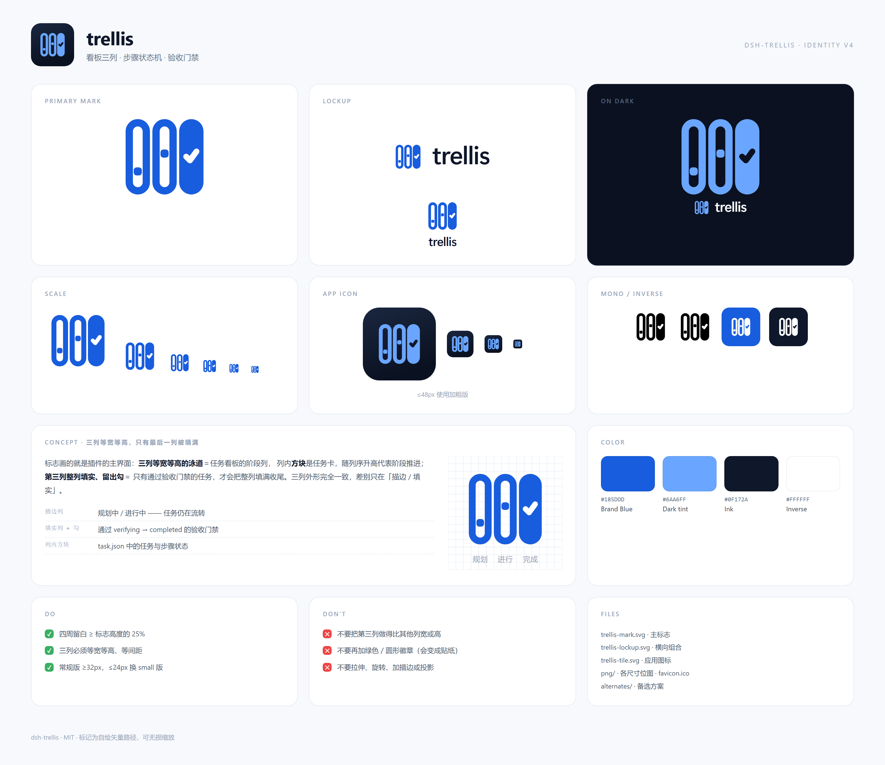

# trellis 标志

`dsh-trellis` 的视觉标识。全部为手绘矢量路径（无字体依赖、无外部资源），可无损缩放。



---

## 1. 设计概念

> **描边是还没收尾的列，实心是已经收尾的列。**

标志画的就是插件的主界面：

| 图形 | 含义 |
| --- | --- |
| 三列圆角泳道 | 任务看板的阶段列；等高列对应 `feat` / `issue` / `refactor` 三条阶段轨道 |
| 列内方形小卡 | `task.json` 里的任务与步骤；卡片逐列升高 = `pending → in_progress → verifying` 的推进 |
| 第三列整列填实 + 留出的勾 | 通过验收门禁、走到 `completed` 的那一列：只有它被填满并打勾 |
| 单一蓝色 + 白勾 | 不引入额外状态色，避免变成「贴纸徽章」 |

> 沿革：v1 用「阶梯 + 勾选」，只能读出「进度 / 完成」；v2 加过绿色圆形 ✓ 徽章，绿色在蓝灰体系里过于抢眼、
> 像贴上去的贴纸。v3 把「完成」交给**形体**（实心 vs 描边）而不是颜色，标志回到单色。
> 旧方案都在 `alternates/` 里。

## 2. 图形规格

- 设计网格 **24 × 24**，主体 x 2.4 → 21.6、y 2.7 → 21.3（居中，四周留白 ≥ 2.4）
- **三列完全等宽、等高、等间距**：列宽 4.2、列高 16.8、圆角 2.1、描边 1.8，列心 x = 3.3 / 9.9 / 16.5，列间距 0.6
- 描边列的外框＝「列宽 + 描边」，所以填实列必须按外框画：x 15.6、宽 **6.0**、高 **18.6**、圆角 **3.0**，
  这样三列的视觉高度与宽度才对得齐
- 任务卡 **2.0 × 2.0**（rx 0.7），分别在 (4.4, 14.6) 与 (11.0, 10.2)
- 勾线宽 **1.45**，从填实列镂空；中心 (18.6, 11.95)

```
描边列  rect x=3.3|9.9   y=3.6  w=4.2  h=16.8  rx=2.1   stroke 1.8   → 外框 6.0 × 18.6
填实列  rect x=15.6      y=2.7  w=6.0  h=18.6  rx=3.0   fill
勾      M17.33 11.95 → 18.27 12.89 → 19.87 10.68   stroke 1.45（镂空）
任务卡  rect 2.0×2.0  rx=0.7  @ (4.4,14.6) (11.0,10.2)
```

## 3. 颜色

| 名称 | 色值 | 用途 |
| --- | --- | --- |
| Brand Blue | `#185DDD` | 全部主体（与看板主色 `--dsw-alias-state-business-primary` 一致） |
| Dark Tint | `#6AA6FF` | 深色底上的主体 |
| Ink | `#0F172A` | 字标 / 单色版 |
| Inverse | `#FFFFFF` | 反白版 |

标志本身不使用插件的状态色（成功绿 `#3BAF62`、告警琥珀 `#F59E0B`、阻断红 `#EF4444`、
缺陷橙 `#F77032`）——那些颜色属于看板 UI 里的状态徽章，混进标志会让它看起来像一个状态贴纸。

## 4. 文件

| 文件 | 用途 |
| --- | --- |
| `trellis-mark.svg` | 主标志（透明底，≥32px 使用） |
| `trellis-mark-small.svg` | 加粗笔画版（24px 及以下、小徽章） |
| `trellis-mark-dark.svg` | 深色背景专用配色 |
| `trellis-mark-mono.svg` | 单色版，颜色跟随 `currentColor` |
| `trellis-mark-inverse.svg` | 纯白反白版（叠在品牌色／图片上） |
| `trellis-tile.svg` | 应用图标 512×512（深色圆角方块） |
| `trellis-tile-small.svg` | 应用图标 ≤48px 版（加粗笔画） |
| `trellis-lockup.svg` | 横向组合（标志 + 字标） |
| `trellis-lockup-dark.svg` | 横向组合 · 深色底 |
| `trellis-lockup-stacked.svg` | 纵向组合（标志在上、字标在下） |
| `png/` | 各尺寸位图：`trellis-mark-16…1024`、`trellis-tile-512/256/48/32/16`、`trellis-lockup@3x` 等 |
| `png/trellis-tile-512.ico` | 多尺寸 favicon（16–256） |
| `alternates/` | 备选：v1 阶梯 + 勾、v2 绿色徽章 |
| `brand-sheet.png` | 品牌规范图（即本页顶部图） |

> 字标 `trellis` 使用 Segoe UI / Inter 系无衬线，600 字重、字距 `-0.03em`。SVG 组合里的字标是
> `<text>`，跨平台可能回退字体；正式发布建议直接用 `png/trellis-lockup@3x.png`，或把字标转为轮廓。

## 5. 插件页图标（`package.json.icon`）

DSH 插件页从包根的 `package.json.icon` 读取图标（也支持导出的 `<specifier>/icon`），
按 `image/svg+xml` 转成 data URL 渲染，尺寸为**行内 30px / 卡片 36px**。
本仓库包根的 **`icon.svg`** 就是给这个位置用的：

- 蓝底（`#185DDD`）+ 白色标志，深浅主题下都在；
- 圆角 22.5%（`rx 5.4 / 24`），`` 以 `object-fit: contain` 渲染，UI 不再二次裁切；
- 标志缩放 0.74，四周留白约 13%，保证 30px 时三列仍分得开；
- 纯路径 + `<mask>` 镂空勾，无外部引用、无字体，可直接当 data URL 用。

品牌展示用的 `trellis-tile.svg` 仍是深色底（适合 README / 分享图），
两者只是底色不同：**入产品用蓝底，做展示用深底**。

## 6. 使用规范

**Do**

- 清除空间 ≥ 标志高度的 **25%**，不要贴边
- 三列必须等宽、等高、等间距（填实列按「列宽 + 描边」的外框画，否则会短一截）
- 常规版 ≥32px；32px 以下换 `trellis-mark-small.svg` / `trellis-tile-small.svg`
- 深底用 `-dark`，单色场景用 `-mono` / `-inverse`
- 位图统一从 SVG 重新导出，不要放大旧的小图

**Don't**

- 不要再给第三列加绿色圆形徽章或换成绿色 —— 「完成」已经由实心形体表达，加色会变成贴纸
- 不要把填实列做得比其他列宽或高，也不要把三列改成不等高 —— 前者露怯，后者变成柱状图
- 不要在列里塞第三张卡片（24px 以下会糊成一团）
- 不要拉伸、旋转、加描边、加投影

## 7. 重新导出位图

任意 SVG → 指定尺寸 PNG（无外部依赖，需本机 Chrome）：

```sh
CHROME="/c/Program Files/Google/Chrome/Application/chrome.exe"
"$CHROME" --headless=new --disable-gpu --hide-scrollbars \
  --default-background-color=00000000 --force-device-scale-factor=1 \
  --window-size=512,512 --screenshot=png/trellis-mark-512.png \
  "file://$PWD/brand/render.html"
```

其中 `render.html` 只放一个 ``。
多尺寸 favicon 用 Pillow 从 `trellis-tile-512.png` 生成即可：

```py
from PIL import Image
Image.open("png/trellis-tile-512.png").save("png/trellis-tile-512.ico",
    sizes=[(16,16),(24,24),(32,32),(48,48),(64,64),(128,128),(256,256)])
```

## 8. README 头部片段（可选）

```html
<p align="center">
  
</p>
```
